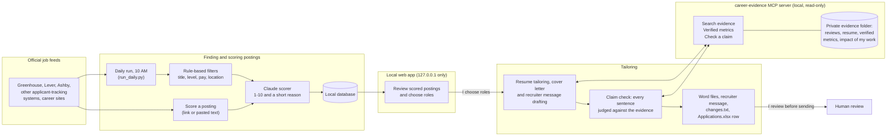

# Job Search Agent

A personal job search agent that runs on a Mac. Every morning it reads official company job feeds, keeps only
the roles that match a set of plain rules, and uses Claude to score each new posting 1-10 for fit against my
resume, with a short reason. I review the results in a local web app, where I can also score any posting by
pasting its link or description. For roles I choose, it drafts a tailored resume, a cover letter and a LinkedIn
message to the company's recruiter, and every claim in them must be backed by my documented work history, which a
local MCP server searches.

## Architecture



## Guardrails

- **Rule-based filters first.** Titles, seniority, pay and location are checked by plain code, not by a model,
  so it's predictable and costs nothing. Only postings that pass are sent to Claude for scoring. Postings I
  add by hand aren't filtered; instead the app warns about each rule they would have failed.
- **Evidence-grounded claims.** The resume and cover letter may only state facts found in my own documents:
  manager, peer and self reviews, my resume, and a verified-metrics file. The career-evidence MCP server finds
  the passages for each posting, and the writing prompts may use nothing else.
- **Claim check: code rules remove, Claude flags.** Free code rules act on their own: every number must
  appear in the verified-metrics file, lines marked [CONFIRM] can't be used, job titles must match the resume,
  and internal codenames and terms are replaced. Then one Claude check per document judges each sentence
  against the evidence; anything doubtful is kept and listed under "FLAGGED FOR YOUR REVIEW" at the top of
  `changes.txt`, with the reason and the evidence to compare it against. I decide what to change.
- **Impact without overclaiming.** `impact_of_my_work.md` records, for each area of my work, what I did (Fact),
  my own view of why it mattered (Perspective), what the product does for people with a public source (Public
  fact), my preferred wording (Say it like this) and the roles it suits (Good fit for). The MCP server labels
  each line: only Fact lines count as evidence of what I did; a Perspective is presented as my view, never a
  measured result; a Public fact is a claim about the product, never something I built; preferred wording is
  a guide, never evidence.
- **Confident positioning, checked in code.** Underselling words ("helped", "supported", "worked on"...) and
  bare "test infrastructure" / "testing" / "test lab" about my work are flagged in the resume, cover letter
  and recruiter message and rewritten (the work is "automated hardware-in-the-loop test infrastructure" or
  "automated continuous integration (CI) testing").
- **Verified metrics are the source of truth.** Numbers come only from one hand-checked file, used exactly as
  written, never rounded, combined or extrapolated. Lines marked as needing confirmation can't be used.
- **Human review before anything is sent.** The agent never applies to anything or sends anything, and never
  contacts LinkedIn. It writes files to a local folder, and I read and edit them before deciding whether to
  apply or send a message myself.
- **Polite, official sources only.** It reads companies' own job feeds, respects every site's robots.txt,
  paces its requests, and never reads LinkedIn or Indeed.

## Key design decisions and trade-offs

| Decision | Why | Trade-off |
|---|---|---|
| Plain-code filters before any model call | Predictable, explainable, free | Rules need tuning by hand; an unusual title can slip through or be missed |
| Score, write and check with the faster model | Keeps the cost per application under about a dollar | Writing and checking quality depend on the faster model; switch `models.writing` or `models.checking` in settings.yaml if either falls short |
| Evidence through a local MCP server | The same search and claim check serve Claude Code and the agent, so the rules can't drift apart | An extra Python environment to maintain |
| Verified-metrics file overrides every other document | One authoritative place for numbers; reviews can be vague or out of date | The file has to be kept up to date by hand |
| Flag doubtful sentences instead of deleting them; only code rules remove | The model's judgment was wrong about half the time, and silent deletions left gaps (once, a letter's key result) | I have to read the flagged list for every application; an unflagged error is still possible |
| Tailor only the summary, skills and most recent role, keeping every one of its bullets | Earlier roles stay exactly as written and are checked for that; the resume and cover letter draw on the same bullets | Less tailoring for postings that match older experience |
| Only official job feeds, with robots.txt and pacing | Reliable data and respectful of each site | Some sites have no readable feed, so those postings must be pasted in |
| Runs locally, web app reachable only from this Mac | Private documents never leave the machine except in requests to Claude | No access from other devices |
| A cost budget per application (default $1), with an exact cost breakdown in `changes.txt` | Spend stays predictable: shared material is cached, the cover letter gets one review and one repair round, and news searches use the faster model | Optional polishing rounds are skipped when they don't fit the budget; the final claim check always runs |
| Write files for review instead of applying automatically | I stay accountable for everything sent under my name | A few minutes of review per application |

## What isn't in this repository, and why

These stay on my Mac only; git ignores them and a pre-commit check blocks them:

- `evidence/`: my performance reviews, peer reviews, self reviews, resume, verified metrics and
  `impact_of_my_work.md`
- `style_examples/`: example cover letters
- `settings.yaml`: my real settings, including the companies I follow and my personal word lists
  (employer-internal terms, codenames, and names from my work history that the claim check watches for)
- `output/` and `Applications.xlsx`: generated resumes, cover letters, recruiter messages and my application log
- `data/`: the local database and logs
- `.env`: the Claude API key

They contain personal and confidential information about me and the people who reviewed my work. The
repository shows how the agent works, not my data.

## How to run it

Requirements: macOS, Python 3.9+ for the agent, Python 3.10+ for the MCP server, and a Claude API key.

```bash
git clone https://github.com/deepafelixgit/job-search-agent.git
cd job-search-agent

# The agent
python3 -m venv .venv
.venv/bin/pip install -r requirements.txt

# The career-evidence MCP server (its own environment; needs Python 3.10+)
python3.12 -m venv .venv-mcp
.venv-mcp/bin/pip install -r mcp_server/requirements.txt

# Your settings and API key
cp settings.example.yaml settings.yaml        # then edit: your name, companies, cities, rules
echo "ANTHROPIC_API_KEY=your-key-here" > .env

# Your evidence (stays private)
mkdir evidence                                # add your resume (.docx), reviews, verified_metrics.txt
```

Then:

| To... | Run |
|---|---|
| Open the web app | `.venv/bin/python app.py`, then go to http://127.0.0.1:5055 |
| Test the job feeds without using Claude | `.venv/bin/python run_daily.py --dry-run` |
| Run once now (fetch, filter, score) | `.venv/bin/python run_daily.py` |
| Turn the 10 AM daily run on or off | `.venv/bin/python setup_schedule.py` or `.venv/bin/python setup_schedule.py --off` |
| Write applications for the queued postings | `/write-application` in Claude Code, or the web app's button |
| Run the offline tests (no API calls) | `.venv/bin/python -m unittest discover tests` and `.venv-mcp/bin/python -m unittest tests.test_impact_reader` |
| Try the evidence tools without Claude | `.venv-mcp/bin/python -m mcp_server.cli search "release program"` |
| Query the agent's results without Claude | `.venv-mcp/bin/python -m mcp_server.postings query --from 2026-11-01 --to 2026-11-30 --min 8` |

To turn on the private-file safety checks, run `git config core.hooksPath .githooks`. Claude Code picks up
the career-evidence server from `.mcp.json` when it's started in this folder.

## Writing applications in Claude Code (no API cost)

The agent finds and scores postings through the Claude API (about a cent per posting). The applications
themselves (tailored resume, cover letter, recruiter message) are written by Claude Code on a Claude
subscription plan, so they cost nothing in API charges. This is `generation_mode: claude_code` in
`settings.yaml`, the default; `generation_mode: api` keeps the old API path.

- **From the web app:** check postings and click "Create custom resume and cover letter". They go into a
  queue (`data/queue.json`) and Claude Code runs in the background (`claude -p "/write-application"`), one
  posting at a time. The "Applications being written" page shows each one as Queued, Writing, Ready or
  Needs your review. If the plan's usage limit is reached, the rest are paused and a Resume button
  continues them from their saved drafts.
- **In Claude Code:** type `/write-application` (the queue), `/write-application <posting id>` or
  `/write-application <posting link>` to watch it work and answer its questions.
- **Billing safety:** Claude Code bills the API whenever an API key is in its environment, so the
  background run starts with every API variable removed, and only after `claude auth status` reports a
  plan login. The run may only read the project, search and fetch web pages, use subagents and the two
  MCP servers, write inside `output/`, and run three no-API helper commands; it can't read `.env`.
- **The skill** (`.claude/skills/write-application/`) holds the process: map the posting's top three
  asks to the strongest evidence, gather company facts once (the Daily Tech Briefing archive in
  `briefing_archive_dir`, then the company's newsroom and the news, then the posting), write the three
  documents, have a fresh subagent review them against a rubric (R1 to R9), and render. Candidate
  specifics live in `settings.yaml` (`personal.positioning`), never in the skill.
- **The renderer** (`python -m agent.render_application <folder>`) builds the documents from the folder's
  `content.json` with the agent's own Word code and formatting, adds page numbers, checks the code rules
  (every Meta bullet kept, pinned bullets exact, numbers in verified_metrics.txt, experience before Meta
  unchanged, the message's limits and courtesy phrases, wording rules), counts pages (cover letter 1,
  resume at most 2; needs LibreOffice, otherwise reported as not counted) and adds the Applications.xlsx
  row. `--resume-map` prints the base resume's parts with their IDs.
- `python -m agent.company_facts "<company>"` prints the briefing archive's stories from the last 120 days
  that name the company. `python -m agent.app_queue list` shows the queue.

Each application folder also holds `content.json`, `notes.txt` (NEEDS YOUR REVIEW first, then the asks
map, company facts, resume changes, rubric results and every claim's source), `sources.txt` and `drafts/`.

## What each output folder holds

For each role I choose, `output/<date>/<Company>_<Role>/` holds:

| File | What it is |
|---|---|
| `<Name>_Resume_<Company>_<Role>.docx` | The tailored resume |
| `<Name>_Cover_Letter_<Company>_<Role>.docx` | The cover letter |
| `<Name>_Recruiter_Message_<Company>_<Role>.txt` | A LinkedIn message to the recruiter, to send myself: a connection request note (at most 200 characters), an InMail subject (at most 200 characters) and body (120-180 words, at most 1,900 characters), and a follow-up for a week later (40-70 words). Code counts every limit and prints the counts; anything still too long after two rewrites is marked TOO LONG at the top, never cut off. Not written for "resume only" runs. |
| `changes.txt` | At the top, the API cost of this application step by step (also logged per call in `data/logs/api_usage.log`). Then every change and why, the evidence used, every sentence's source, what was removed, and for the recruiter message: "choices", "why this company" and its claim check |
| `sources.txt` | The verified news used, and the one web search the recruiter message may run |

If the recruiter message fails, the resume and cover letter are still kept and `changes.txt` says why.

## Project layout

| Path | Purpose |
|---|---|
| `run_daily.py` | The daily fetch, filter and score run |
| `app.py`, `templates/` | The local web app, including "Score a posting" |
| `agent/fetchers.py`, `agent/site_readers.py` | Readers for each kind of job system |
| `agent/http.py`, `agent/robots.py` | Request pacing and retries; robots.txt checks |
| `agent/filters.py` | Title, level, pay and location rules |
| `agent/scorer.py` | Claude fit scoring |
| `agent/manual.py` | Scoring a posting from a link or pasted description |
| `agent/evidence_gate.py` | Finding evidence for a posting, and the claim check |
| `agent/tailor.py`, `agent/resume.py` | Resume tailoring and Word file handling |
| `agent/letter.py`, `agent/style.py` | Cover letter planning, drafting, critique and checks |
| `agent/recruiter.py` | The LinkedIn message to the recruiter: choices, why this company, draft, limits, claim check |
| `agent/personal.py` | Reads the personal word lists from `settings.yaml` (kept out of the code) |
| `agent/generate.py`, `agent/sheet.py` | Output folders, `changes.txt` and the application log |
| `mcp_server/postings.py` | The job-postings MCP server: answers questions about the agent's results (read-only) and writes query results to a new tab in Applications.xlsx |
| `mcp_server/` | The career-evidence MCP server: search, verified metrics, claim check (`candidate.py` reads your name and abbreviations from `settings.yaml`) |
| `.claude/skills/write-application/` | The write-application skill: process, writing rules, rubric, content format |
| `agent/render_application.py` | Builds an application's documents from `content.json` and runs the code checks (no API) |
| `agent/app_queue.py`, `agent/claude_runner.py` | The application queue, and the background Claude Code run (billing-safe) |
| `agent/company_facts.py` | Reads the Daily Tech Briefing archive for company facts (no API) |
| `CLAUDE.md` | Rules Claude Code follows when working on resumes and letters in this project |

## Who built it

I designed this agent: what it does, the guardrails, the rules and the review workflow. Claude Code wrote the
code, working from my requirements and feedback.
