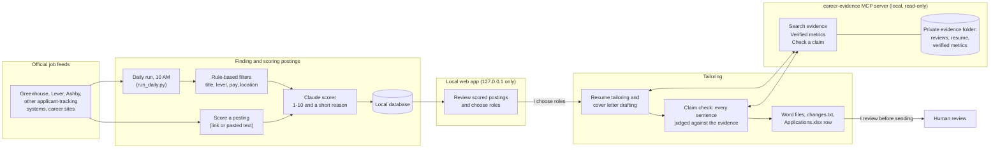

# Job Search Agent

A personal job search agent that runs on a Mac. Every morning it reads official company job feeds, keeps only
the roles that match a set of plain rules, and uses Claude to score each new posting 1-10 for fit against my
resume, with a short reason. I review the results in a local web app, where I can also score any posting by
pasting its link or description. For roles I choose, it drafts a tailored resume and cover letter, and every claim
in them must be backed by my documented work history, which a local MCP server searches.

## Architecture



## Guardrails

- **Rule-based filters first.** Titles, seniority, pay and location are checked by plain code, not by a model,
  so it's predictable and costs nothing. Only postings that pass are sent to Claude for scoring. Postings I
  add by hand aren't filtered; instead the app warns about each rule they would have failed.
- **Evidence-grounded claims.** The resume and cover letter may only state facts found in my own documents:
  manager, peer and self reviews, my resume, and a verified-metrics file. The career-evidence MCP server finds
  the passages for each posting, and the writing prompts may use nothing else.
- **Claim check.** After drafting, every sentence is judged against the evidence. Code rules back that up:
  every number must appear in the verified-metrics file, internal codenames and terms are replaced, and job
  titles must match the resume. Unsupported sentences are removed, and `changes.txt` lists each one with the
  reason.
- **Verified metrics are the source of truth.** Numbers come only from one hand-checked file, used exactly as
  written, never rounded, combined or extrapolated. Lines marked as needing confirmation can't be used.
- **Human review before anything is sent.** The agent never applies to anything or sends anything. It writes
  files to a local folder, and I read and edit them before deciding whether to apply.
- **Polite, official sources only.** It reads companies' own job feeds, respects every site's robots.txt,
  paces its requests, and never reads LinkedIn or Indeed.

## Key design decisions and trade-offs

| Decision | Why | Trade-off |
|---|---|---|
| Plain-code filters before any model call | Predictable, explainable, free | Rules need tuning by hand; an unusual title can slip through or be missed |
| Score with a faster model, write with the most capable one | Scoring runs on many postings; writing runs on a few | Two models to keep current |
| Evidence through a local MCP server | The same search and claim check serve Claude Code and the agent, so the rules can't drift apart | An extra Python environment to maintain |
| Verified-metrics file overrides every other document | One authoritative place for numbers; reviews can be vague or out of date | The file has to be kept up to date by hand |
| Remove unsupported sentences rather than rewrite them freely | A shorter, true letter beats a fluent one with an invented claim | Letters sometimes come out shorter and need a human touch |
| Tailor only the summary, skills and most recent role | Earlier roles stay exactly as written and are checked for that | Less tailoring for postings that match older experience |
| Only official job feeds, with robots.txt and pacing | Reliable data and respectful of each site | Some sites have no readable feed, so those postings must be pasted in |
| Runs locally, web app reachable only from this Mac | Private documents never leave the machine except in requests to Claude | No access from other devices |
| Write files for review instead of applying automatically | I stay accountable for everything sent under my name | A few minutes of review per application |

## What isn't in this repository, and why

These stay on my Mac only; git ignores them and a pre-commit check blocks them:

- `evidence/`: my performance reviews, peer reviews, self reviews, resume and verified metrics
- `style_examples/`: example cover letters
- `settings.yaml`: my real settings, including the companies I follow and my personal word lists
  (employer-internal terms, codenames, and names from my work history that the claim check watches for)
- `output/` and `Applications.xlsx`: generated resumes, cover letters and my application log
- `data/`: the local database and logs
- `.env`: the Claude API key

They contain personal and confidential information about me and the people who reviewed my work. The
repository shows how the agent works, not my data.

## How to run it

Requirements: macOS, Python 3.9+ for the agent, Python 3.10+ for the MCP server, and a Claude API key.

```bash
git clone https://github.com/deepafelixgit/job-search-agent.git
cd job-search-agent

# The agent
python3 -m venv .venv
.venv/bin/pip install -r requirements.txt

# The career-evidence MCP server (its own environment; needs Python 3.10+)
python3.12 -m venv .venv-mcp
.venv-mcp/bin/pip install -r mcp_server/requirements.txt

# Your settings and API key
cp settings.example.yaml settings.yaml        # then edit: your name, companies, cities, rules
echo "ANTHROPIC_API_KEY=your-key-here" > .env

# Your evidence (stays private)
mkdir evidence                                # add your resume (.docx), reviews, verified_metrics.txt
```

Then:

| To... | Run |
|---|---|
| Open the web app | `.venv/bin/python app.py`, then go to http://127.0.0.1:5055 |
| Test the job feeds without using Claude | `.venv/bin/python run_daily.py --dry-run` |
| Run once now (fetch, filter, score) | `.venv/bin/python run_daily.py` |
| Turn the 10 AM daily run on or off | `.venv/bin/python setup_schedule.py` or `.venv/bin/python setup_schedule.py --off` |
| Try the evidence tools without Claude | `.venv-mcp/bin/python -m mcp_server.cli search "release program"` |

To turn on the private-file safety checks, run `git config core.hooksPath .githooks`. Claude Code picks up
the career-evidence server from `.mcp.json` when it's started in this folder.

## Project layout

| Path | Purpose |
|---|---|
| `run_daily.py` | The daily fetch, filter and score run |
| `app.py`, `templates/` | The local web app, including "Score a posting" |
| `agent/fetchers.py`, `agent/site_readers.py` | Readers for each kind of job system |
| `agent/http.py`, `agent/robots.py` | Request pacing and retries; robots.txt checks |
| `agent/filters.py` | Title, level, pay and location rules |
| `agent/scorer.py` | Claude fit scoring |
| `agent/manual.py` | Scoring a posting from a link or pasted description |
| `agent/evidence_gate.py` | Finding evidence for a posting, and the claim check |
| `agent/tailor.py`, `agent/resume.py` | Resume tailoring and Word file handling |
| `agent/letter.py`, `agent/style.py` | Cover letter planning, drafting, critique and checks |
| `agent/personal.py` | Reads the personal word lists from `settings.yaml` (kept out of the code) |
| `agent/generate.py`, `agent/sheet.py` | Output folders, `changes.txt` and the application log |
| `mcp_server/` | The career-evidence MCP server: search, verified metrics, claim check (`candidate.py` reads your name and abbreviations from `settings.yaml`) |
| `CLAUDE.md` | Rules Claude Code follows when working on resumes and letters in this project |

## Who built it

I designed this agent: what it does, the guardrails, the rules and the review workflow. Claude Code wrote the
code, working from my requirements and feedback.
